# CareSchedule 🩺

### Multi-Doctor Healthcare Portal

CareSchedule is a healthcare application designed to help patients manage their healthcare activities in one place. It aims to simplify doctor appointments, prescriptions, medical history, and follow-up reminders.

## ✨ Key Features

- **Doctor Appointments:** Manage appointment-related activities.
- **Prescription Management:** Scan prescriptions and review recognized medicine names.
- **Medical History:** Keep relevant health information organized.
- **Medical Reports:** Access and organize medical reports.
- **Reminders:** Manage reminders for medicines, appointments, and health check-ups.
- **Health Profile:** Maintain patient health details.

## 🛠️ Technologies Used

- **Frontend:** Flutter and Dart
- **Backend:** Node.js and Express.js
- **Database:** MongoDB

## 📁 Project Structure

```text
CareSchedule/
├── backend/    # Server and API
├── frontend/   # Flutter application
└── .gitignore  # Files excluded from Git
```

## 📱 Application Screenshots

### Splash Screen
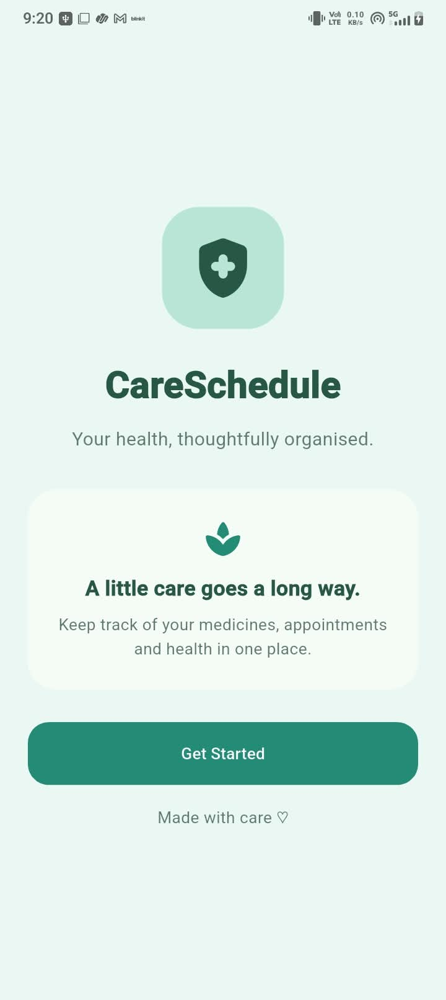

### Home Dashboard
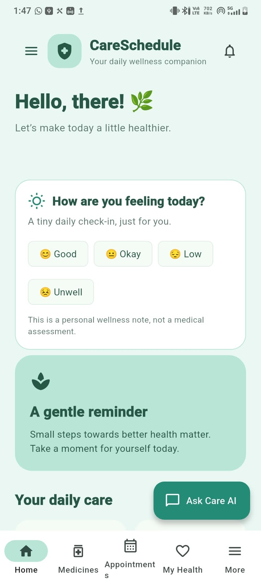

### More Features
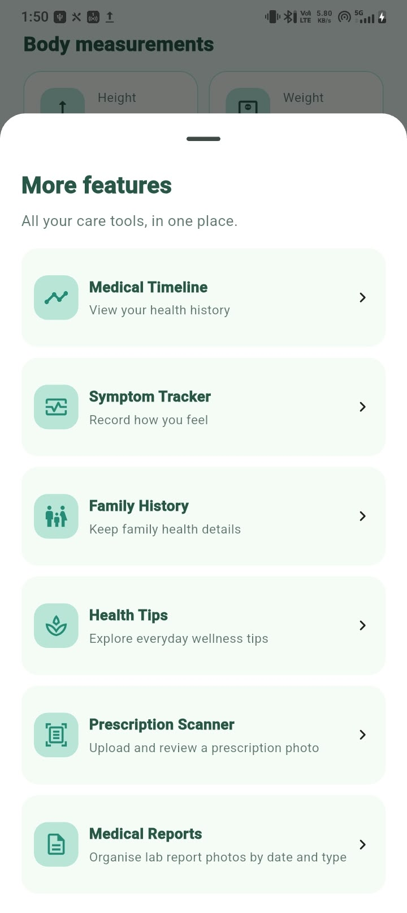

### Medicine Management
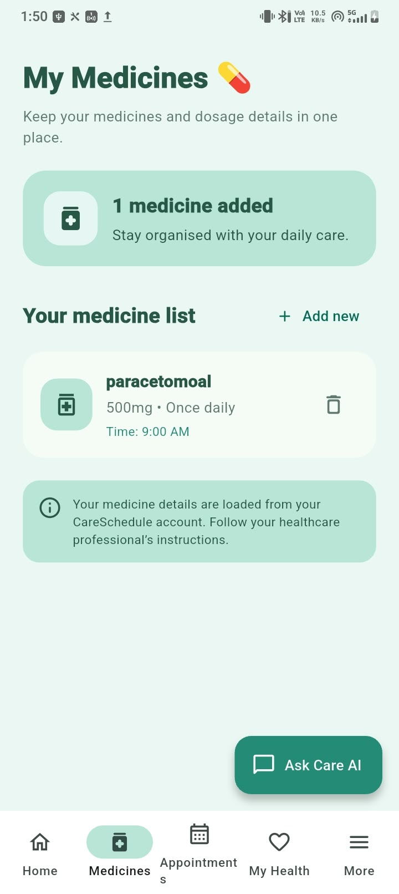

### Appointments
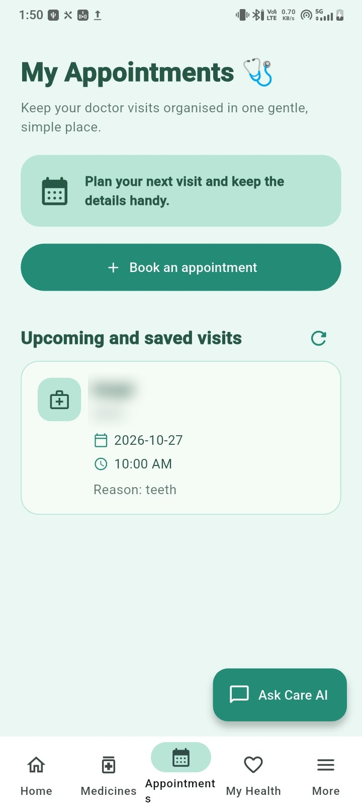

### My Health Profile
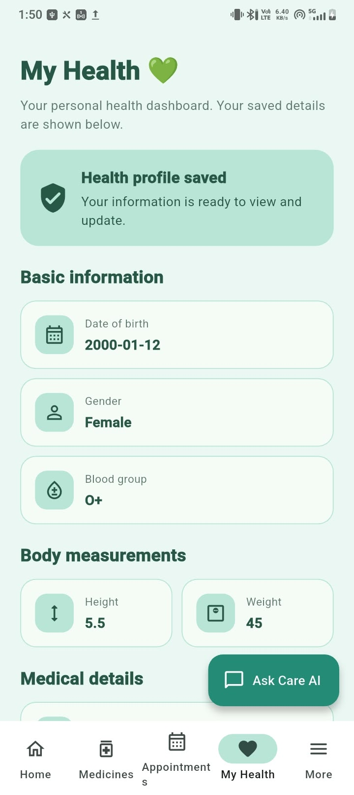

### Symptom Tracker
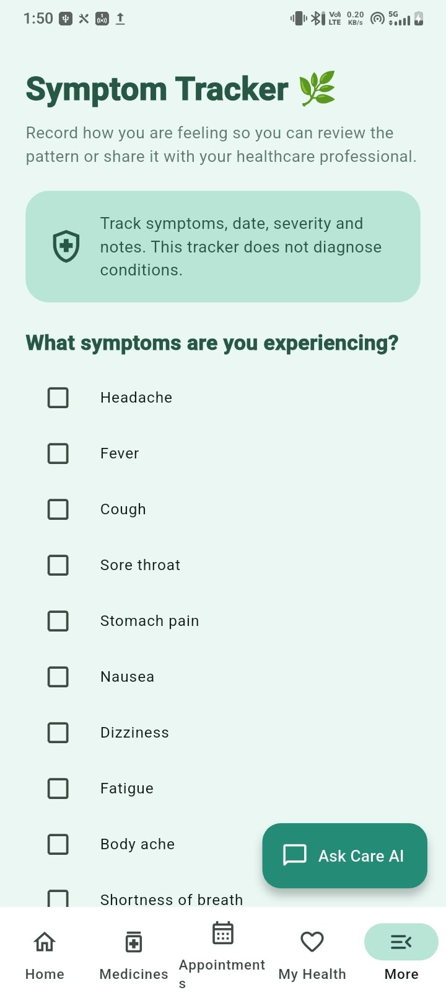

### Care Reminders
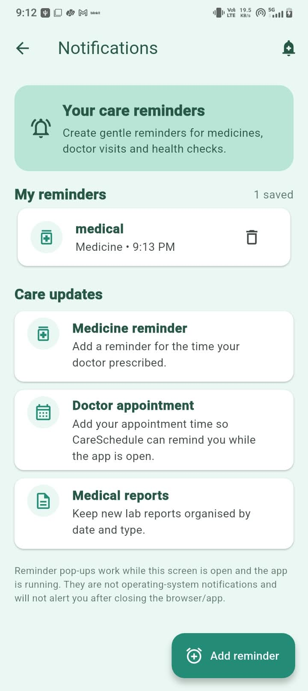

### Medicine Checker
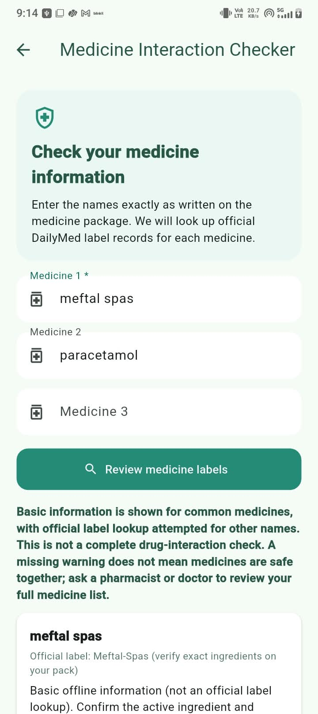

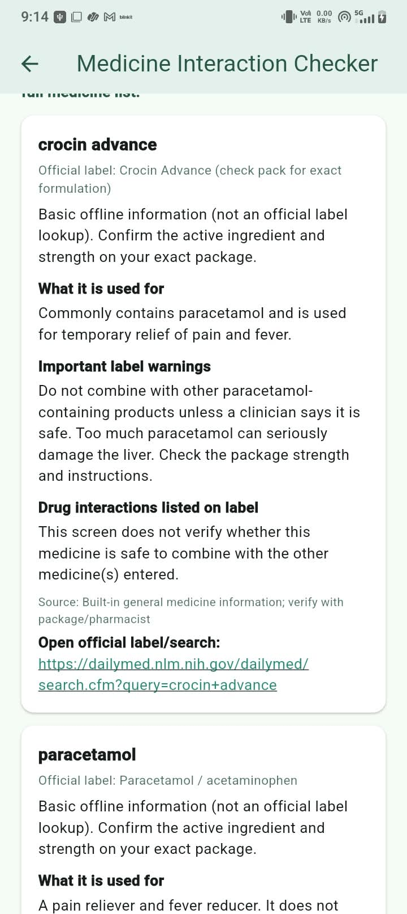

### Emergency SOS
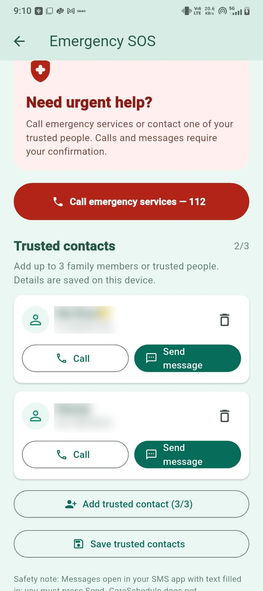


## 👩‍💻 Repository

[View CareSchedule on GitHub](https://github.com/bhumipandey3/CareSchedule)
